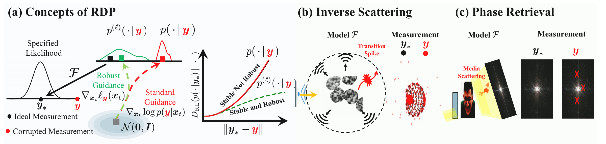

# Outlier-robust Diffusion Posterior Sampling

Implementation for [Outlier-robust Diffusion Posterior Sampling for Bayesian Inverse Problems, NeurIPS 2026](https://arxiv.org/abs/2602.02045).

[](figures/demo.pdf)

This repository is developed based on [InverseBench](https://github.com/devzhk/InverseBench), and we gratefully acknowledge the original authors for their contributions.

## Setup

Use Python 3.11 and a PyTorch-compatible environment. Install PyTorch for your CUDA setup, then, set up the environment with the following command:

```bash
pip install -r requirements.txt
```

Download the two checkpoints from the
[InverseBench diffusion-prior release](https://github.com/devzhk/InverseBench/releases/tag/diffusion-prior):

| Task | File under `checkpoints/` |
|---|---|
| Inverse scattering | `inv-scatter-5m.pt` |
| All FFHQ tasks | `ffhq256.pt` |

Use the inverse-scattering test LMDB provided by
[InverseBench](https://github.com/devzhk/InverseBench) and linked from its
[dataset record](https://data.caltech.edu/records/jfdr4-6ws87).
The record links to the current dataset version. Extract the test LMDB to
`data/inv-scatter-test/`; it must contain `data.mdb` with decimal-string keys
and float32 arrays of shape `(1, 128, 128)`.
Place FFHQ images in `data/ffhq256/`. Explicit sample IDs use five-digit image
names such as `00000.png`; arbitrary image filenames use sorted positions.

## Demo

```bash
jupyter notebook demo.ipynb
```

Run the notebook from the repository directory. It loads one test example and
compares DPS, RDP-DPS, LGD, and RDP-LGD using the **same observation and seed**.
It saves reconstructions, PSNR/SSIM/NMAE, and a comparison figure to `results/demo/`.
The default is 1000 VP steps. Set `RDP_DATA` and `RDP_CHECKPOINT` before opening
the notebook to use external data and checkpoint paths.

## Run a task

```bash
python run.py --task scattering --sampler dps --robust imq --noise outlier
```

Use `--data`, `--checkpoint`, `--ids 0-9`, `--steps`, `--quantile`, `--seed`,
`--device`, and `--output` to override defaults. `--save-every 100` also saves
intermediate reconstructions. 

```bash
python evaluate.py results/scattering/dps/outlier/imq
```

FFHQ evaluation also reports LPIPS and VIF loss. `piq.LPIPS` receives saved
images directly in `[0, 1]` and applies ImageNet normalization internally;
metric weights may be downloaded on first use. Its input convention is documented
in the [PIQ 0.8.0 source](https://github.com/photosynthesis-team/piq/blob/v0.8.0/piq/perceptual.py).
Optional `--source-frechet` preserves the original `FID.py` implementation:
torchvision Inception-v3 **logits**, ImageNet preprocessing, and covariance
ridge `500`. It is named `source_frechet` because it differs from standard
pool3 FID; scores from those conventions should be reported separately.

## Citation

```bibtex
@inproceedings{
    yang2026outlierrobust,
    title={Outlier-robust Diffusion Posterior Sampling for Bayesian Inverse Problems},
    author={Yiming Yang and Xiaoyuan Cheng and Yi He and Kaiyu Li and Wenxuan Yuan and Zhuo Sun},
    booktitle={The Fortieth Annual Conference on Neural Information Processing Systems},
    year={2026},
    url={https://openreview.net/forum?id=a4Z54rVG8B}
    }
```
